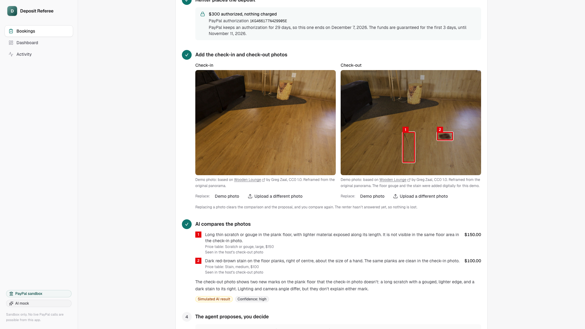

# Deposit Referee

> **For hosts who rent out a cabin, a room or gear on their own, with no AirCover.** A guest leaves, there's a new scratch, and the guest says it was already there. With Deposit Referee the money stays on a PayPal hold; only what you approve is captured. Claude compares the check-in and check-out photos and boxes the new damage, the renter sees the same evidence and can contest, and nothing moves until the host approves, inside limits set by code.

**Status:** live at https://deposit-referee.onrender.com on the PayPal sandbox with Claude (Sonnet 5.5 for the photos, Haiku 5.5 for the agent), under an app-side daily AI spend cap · **Video (≤3 min):** <!-- TODO: YouTube link --> · **License:** MIT

**Holds:** PayPal guarantees an authorized deposit for 3 days and lets it be captured until day 29. A charge after day 3 refreshes the hold first (a PayPal reauthorization). That suits stays and gear rentals; it doesn't suit long leases.



## Why this matters

**More than half of hosts have had a guest damage their place**: 53% in an [Aviva poll of 1,000 UK hosts (2019, reported by YourMoney)](https://www.yourmoney.com/insurance/theft-warning-for-home-share-hosts/), and 60% in the past year in a [Hospitable survey (2026)](https://en.10minhotel.com/?p=215240). Hosts who rent a cabin, a room or gear from their own website have no platform protection, so they keep the deposit and risk a chargeback, or let it go.

- **Hosts often pay for damage themselves.** Of the hosts with guest damage, 66% paid for the repairs themselves ([Hospitable, 2026](https://en.10minhotel.com/?p=215240)). Airbnb's host damage protection applies when you host on Airbnb ([Airbnb Help Center](https://www.airbnb.com/help/article/3733)). Here the deposit sits on a PayPal hold, so there is money to draw on without a platform.
- **Nobody can prove what was there before.** "It was already there" came up in 7 of the 14 host and guest stories we read; one forum reply puts it as "They have to show the table was damage free prior to your rental" ([Rick Steves Travel Forum, 2024](https://community.ricksteves.com/travel-forum/tourist-scams/sos-airbnb-host-accused-me-of-damage)). In the same Aviva poll of 1,000 UK guests, 13% who broke something blamed someone else ([YourMoney](https://www.yourmoney.com/insurance/theft-warning-for-home-share-hosts/)). Here both sides can add check-in photos, and Claude boxes only what is new at check-out.
- **Charges look inflated and fall apart under questions.** In the same forum thread, a claim of about 600 EUR fell to 150 EUR once the guest asked for receipts, then lapsed. Here every line has its photo and a price-table row, and the renter can contest one line instead of the whole deposit.
- **Card holds run out, and a kept deposit invites a chargeback.** Online card holds through Stripe usually last 7 days ([Stripe docs](https://docs.stripe.com/payments/capture-later)); hosts warn of "the security deposit getting hit with a chargeback" ([OwnerRez forum, 2024](https://www.ownerrez.com/forums/general-help/airbnb-reservation-and-api-connected-damage-deposit-collected-directly-via-stripe)). A PayPal authorization is valid for 29 days and you can capture from it more than once ([PayPal docs](https://developer.paypal.com/docs/checkout/standard/customize/authorization/)). Here the renter's accept is on record and the evidence pack is ready if they dispute. That lowers the chargeback risk; it can't remove it.

Partial capture itself isn't unique to PayPal (Stripe can capture less than the hold too). What this app uses is the 29-day authorization and several captures on one hold, so the items a renter accepts are charged at once and the contested ones wait on the same hold.

## How this differs

Photo inspection and deposit replacement already exist. Each line below says only what that product's own page says (read 8 Nov 2026):

| Product | Kind | What its page says it does |
|---|---|---|
| [Witnessed](https://www.producthunt.com/products/witnessed) | AI inspection | Compares photos from the start and end of a stay or rental, tells normal wear from possible damage, and makes shareable PDF reports |
| [RentSolve AI](https://rentsolve-site.pages.dev/features/damage-deduction-reports) | AI inspection | Itemized deduction reports with photo evidence and repair estimates, emailed to the tenant |
| [CheckEasy](https://www.checkeasy.co/en) | AI inspection | AI check-in and check-out reports for short-term rentals; saves the guest's card "without holding anything" and charges after damage, backed by the report |
| [VerifyAI (Switch Labs)](https://verify.switchlabs.dev/use-cases/rental-return-verification) | Photo API | An API and SDKs that compare checkout and return photos for new damage, missing parts and cleanliness |
| [Truvi, formerly Superhog](https://truvi.com/damage-protection) | Damage protection | Damage protection with "no guest deposits or waivers required"; claim payouts go to the host |
| [Waivo](https://www.futurestay.com/built-in-partners/waivo) | Damage waiver | A non-refundable guest fee that "replaces traditional security deposits", with $1,500 of cover |
| [Obligo](https://www.obligo.com/blog/obligo-a-better-security-deposit-alternative) | Lease deposit alternative | Renters link a payment method instead of paying a lease deposit, and owners can charge up to the deposit amount; a non-refundable fee applies |

What Deposit Referee does that none of those pages describes:

- **The hold stays on PayPal.** The renter's money is authorized, not taken and not replaced by a fee. Only what the host approves is captured; the rest is released.
- **Several captures on one hold.** The lines the renter accepts are captured at once with `final_capture: false`, and the contested part stays on the same authorization until the host decides.
- **The renter contests line by line.** The renter sees each line with its photo and price-table row and accepts or contests each one before anything moves.
- **The renter's contest gets a second look, and the charge can only fall.** The renter attaches their own photo to a contested line; Claude re-reads that line against it, code maps the verdict to an amount that can only stay or drop, and an agent sends the counter. RentSolve's page describes a tenant response log for the landlord, not a re-evaluation from the tenant's evidence.

That is what those public pages say, not proof that none of them does it. The photo comparison itself is a crowded niche, and Claude doing it isn't unique.

## How far to trust the photo comparison

A blind test on the real API, before this build was frozen: 10 new pairs made from CC0 photos of real rooms with digitally added marks.

| Pairs | Count | Result |
|---|---|---|
| No new damage | 5 | 0 charged, 0 flagged |
| One new mark | 5 | 3 charged, 1 Worth a look, 1 missed (a crack across a floor tile) |
| Obvious damage, and the demo pair | 4 | 4 charged |

**0 false charges.** A small sample, and both photos in each test pair come from one capture, so real photos may do worse.

**Worth a look, nothing charged.** When Claude sees a mark but isn't sure it's new, or calls it faint, it goes under **Worth a look** with an amber box on the photo. Code never charges it unless the host adds it, and then it goes to the renter and the approval card like any other line.

## The problem

Airbnb's AirCover and Turo's protection plans settle damage inside their platforms. A host who rents out a cabin from their own website, or lends out a trailer or a camera kit, has nothing like that. Anyone who does knows this argument. A renter leaves, the host finds a long scratch in the floor, and each side remembers it differently. If the host already has the deposit, the renter has to chase it back. If the host doesn't, there's no easy way to charge for real damage. Deposit Referee keeps the money on a PayPal hold, puts the evidence on one page both sides can read, and charges only what the host approves.

## What it does

1. The host creates a booking with a deposit, for example $300 for a lakeside cabin.
2. The renter places the deposit on their own page (it fits a phone): a PayPal order with `intent=AUTHORIZE`. The money is held, not taken. Until then the host's page says "Waiting for the renter's hold"; once PayPal returns the hold it says "$300 authorized, nothing charged" with the authorization id. PayPal guarantees the funds for 3 days and lets the hold be captured until day 29; both pages show the dates.
3. Check-in and check-out photos go on the booking, each with its source shown.
4. Claude compares the two photos, itemizes new damage and draws a red box on it. While it works, the page shows a live list of steps (hold confirmed, photos in, Claude comparing with the seconds so far, price table, proposal ready), never a bare spinner.
5. The settlement agent reads that review, checks the order and the hold through PayPal's tools, and proposes a charge or a full release with its evidence. Then it stops. It has no tool that can move money.
6. The renter opens their own link, sees the proposal, the photos and the reasons, and accepts or contests it. A contest stops the capture and brings their note back to the host. It's a note inside this app, not a PayPal dispute.
7. The host can change any amount, since the AI's figures are proposals, not repair quotes, and adds a one-line reason the renter sees. Raising a charge goes back to the renter. Then the host sends the charge or release to the Guard's approval step. The approval is the main card on the page: each line with its price-table row, the renter's answer on each, "Capture $150.00 · release $150.00" and the Guard's reason for stopping. No money moves before the host clicks Approve (an end-to-end test waits and re-checks that nothing was captured or voided), and declining moves nothing and keeps the booking open.
8. PayPal captures exactly that amount, the rest of the hold is voided, and the result screen shows, for example, "$150 captured, $150 released", re-read from PayPal. With no damage the whole hold is voided and re-read: "$0 captured, $300 released".

**Split capture.** When the renter accepts some items and contests others, the host can charge the accepted items at once (after the same approval step), as a capture with `final_capture: false`. The contested part stays on the same hold until a person settles it, with a second capture from that hold or a release; the settlement then voids what's left. PayPal can't shrink a hold, so the app's own limit keeps the second charge to the contested amount. On the sandbox both captures and the void are re-read from PayPal.

**Second look.** When the renter contests a line, they can attach their own photo of it (camera or file) with their note. Claude Sonnet re-reads each contested line against the host's photos and the renter's evidence, with the note passed as quoted data, never as instructions, and names one verdict: `new`, `already_there`, `smaller` or `unsure`. Code turns it into the amount (`src/lib/deposit/second-look-rules.ts`): already there or unsure goes to $0 (a contested line Claude can't stand behind is never charged, like a faint mark), smaller takes the price-table row for the smaller size only if that is lower, and new leaves the line as it was. No verdict can raise a line; a unit test checks every verdict, size and amount. On the host's page the line's box turns grey and the total falls. The counter agent (Claude Haiku, no money tool) reads the second look and writes the counter for both sides; the host sends it with one click, the renter accepts on their phone, and the charge or release goes to the host's approval gate. The accepted items were already captured with `final_capture: false`, so a lowered line that still charges something is a second capture from the same hold, then the rest is voided.

**The renter's own photos.** Until the host compares the photos, the renter can add their own check-in or check-out photo from their link. Claude weighs them with the host's: damage that either check-in photo already shows isn't charged, and each finding says which photo it was seen in ("Seen in the host's check-out photo").

**Dispute pack.** Once anything is charged, the host can download an evidence pack (PDF): the photos with each finding boxed and numbered, every line with its price-table row and the photo it was seen in, the renter's accept or contest record and every PayPal id. If the renter disputes the charge with PayPal, the `CUSTOMER.DISPUTE.CREATED` webhook files the dispute under its booking, and the settlement agent reads it with the Agent Toolkit's `get_dispute`. The host sees the case, the renter's message and the deadline, and can send the pack to PayPal. That submission is a guarded tool (`submit_dispute_evidence`) that waits for the host's approval like a charge.

The **Dashboard** shows what's held, charged and released by property, and for each booking what the AI said and what the host charged (for example "AI said $150.00, you charged $90.00 (−$60.00)").

The booking page keeps the PayPal calls folded into one line, **PayPal calls (n)**; one click shows every call with its HTTP status and `debug_id`.

### Limits in code

These live in `src/lib/deposit/rules.ts` and `src/agents/tools/capture-deposit.ts`, not in the prompt:

- **The price comes from a published table, not the AI** (`src/lib/deposit/prices.ts`). Claude names each mark's kind (scratch, dent, stain, hole...) and size (small, medium, large); the amount is that table row, so the same scratch always costs the same. Each line shows its row ("Price table: Scratch or gouge, large, $150"), and the whole table is one click away for the host and the renter. The agent picks which findings it stands behind but sets no amounts. The host can still change a line to their real cost and says why.
- **A faint mark is never charged.** Claude says whether each mark is clear or faint and how sure it is that the mark is new. A faint mark, one it rates low, or any mark on a low-confidence answer goes to **Worth a look** with no charge, by code, whatever else the answer says.
- All amounts are integer cents, and released is authorized minus captured. It never comes from the AI, because a partly captured voided authorization still reads its full amount at PayPal.
- A capture can't exceed the itemized lines or the amount held, whatever is asked. Both are checked when the host asks, again before the approval prompt, and again from PayPal's own numbers just before the capture.
- The capture tool only runs for a charge the host asked for and approved. An agent calling it directly is refused.
- A charge can't reach the approval step until the renter has accepted it, contested it (and the host has seen the note), or let their window lapse. The window is 48 hours, or ends an hour before the hold does. Accepting one amount doesn't cover a higher one.
- After a contest the charge can only stay the same or go down. Claude's second look can only lower a contested line: the model names a verdict, and the amount is the price-table row or $0, never more than the line was.
- A charge on an expired hold is refused.
- A charge more than 3 days after the hold was placed, past PayPal's honor period, first refreshes the hold: the capture tool reauthorizes the same amount and charges the new authorization, and the PayPal calls show **Hold refreshed**. A release voids the original hold, which voids both. If PayPal refuses the reauthorization, the original hold is charged as before. The sandbox can't age a hold, so this is proven by unit tests on a mocked clock (`tests/unit/hold-refresh.test.ts`), not on the sandbox.

**Test the limit** (under **For judges** on the booking page) has a scripted agent call the capture tool for one cent over the hold, through the real tool and Guard. It's refused by code before PayPal, logged, and the hold doesn't change. Unit tests cover the other routes in: a proposal over the hold, a capture over the itemized lines, and an agent capturing without the host.

## How PayPal is used

All PayPal calls go to the **sandbox** (`https://api-m.sandbox.paypal.com`); there is no live mode in the code. Every call shows under **PayPal calls** on the booking page with its HTTP status and PayPal `debug_id`.

| PayPal API | Endpoint(s) | Where and why |
|---|---|---|
| JS SDK v6 (buyer approval) | `web-sdk/v6/core`, `PayPalOneTimePaymentButton` | The renter approves the deposit with the PayPal button. Judges can use the sandbox test card instead, because they have no buyer login |
| Orders v2 | `POST /v2/checkout/orders` (intent `AUTHORIZE`), `/authorize`, `GET /v2/checkout/orders/{id}` | Places the deposit as a hold, so nothing is charged. The settlement agent reads the order before it proposes |
| Payments v2 | `GET /v2/payments/authorizations/{id}`, `/capture`, `/void`, `GET /v2/payments/captures/{id}` | Charges the exact amount the host approved, releases the rest of the hold, then re-reads both so the result screen shows PayPal's numbers |
| Webhooks | `POST /v1/notifications/verify-webhook-signature` | Verified webhooks update the app's ledger and appear on the timeline of the booking they belong to |
| Disputes v1 | `GET /v1/customer/disputes/{id}`, `POST /v1/customer/disputes/{id}/provide-evidence` | Reads a renter's dispute when its webhook arrives, and sends the evidence pack (PDF, evidence type `OTHER`) after the host approves |
| **PayPal Agent Toolkit** | `@paypal/agent-toolkit` 1.11 tools: `get_order`, `get_dispute` | Every read of a hold goes through the Toolkit's `get_order`, because the order carries its authorizations and their captures: the agent's `get_authorization`, and the checks inside `capture_deposit`, `capture_accepted_items` and `void_authorization`, all behind the Guard. Toolkit 1.11 has no tool to capture from a hold, void one or reauthorize it, so those three use the kit's own Payments v2 calls behind the same Guard. Each row of **PayPal calls** names the tool that made it and says so plainly where the Toolkit has none. |

**Safety around money:** every money-moving agent call passes a guard. It enforces a per-action cap, a daily cap, a payee allowlist and idempotency (`PayPal-Request-Id`), and makes `capture_deposit`, `capture_accepted_items`, `release_deposit` and `submit_dispute_evidence` wait for the host at any amount. Every decision goes to a hash-chained, append-only audit log.

## How AI is used

| Where | Model | What it does |
|---|---|---|
| Settlement agent | Claude Haiku 5.5 (`claude-haiku-5-5`) | Reads the photo review and the hold in a tool loop, then proposes a charge or release with its evidence and stops; explains each step on the timeline |
| Photo review | Claude Sonnet 5.5 (`claude-sonnet-5-5`) | Vision: compares the two photos, and returns itemized damage with boxes as structured data |
| Second look | Claude Sonnet 5.5 | Vision: re-reads each line the renter contested against their own photo and note, and names a verdict (new, already there, smaller, unsure); code sets the amount |
| Counter agent | Claude Haiku 5.5 | Reads the second look with `read_second_look` and writes the counter-offer for both sides with `propose_counter`; it has no money tool |

- **Agent loop**: Claude's tool use via the Anthropic TypeScript SDK (`@anthropic-ai/sdk`), with adaptive thinking and summarized reasoning shown on the timeline.
- **Structured output**: zod schemas through the Messages API's structured outputs (`output_config.format`).
- **Cost control**: a hard daily spend cap (worst case reserved before every call), per-IP rate limits, and Haiku for everything except the photo comparison.
- **When the AI can't run**: if the account is out of credit or the daily cap is spent, the host gets a plain message. No money moves, the deposit stays on hold, and the same booking can carry on later.
- **Mock mode**: without an API key the app runs a clearly labelled scripted agent, so the demo works anywhere. The hosted demo runs real Claude; each photo review shows its model and cost.

**Built with AI.** This project was built with **Claude Code** (Anthropic's coding agent), which wrote the code under human direction. It started from a shared starter kit that Claude Code also wrote. The product idea, scope and review were human decisions.

## Architecture

```
Browser (Next.js 16 / React 19, Tailwind, AG Grid, AG Studio behind a build switch)
  │  PayPal JS SDK v6 button ─────────────► PayPal sandbox checkout (buyer approval)
  │  SSE /api/events (live timeline)
  ▼
Next.js route handlers (Node)
  ├─ lib/paypal   typed PayPal client: sandbox REST (OAuth cache, PayPal-Request-Id, debug_id) or in-memory mock
  ├─ lib/agent    Claude tool-use loop → Guard (caps, allowlist, approvals, idempotency, audit) → tools
  │                 tools = PayPal Agent Toolkit 1.11 + guarded extensions
  ├─ lib/ai       Claude Haiku 5.5 / Sonnet 5.5: structured output, vision, streaming; daily spend cap
  ├─ webhooks     verify → ledger → handlers
  └─ .data/       local JSON: ledger, audit log, AI spend (mock PayPal state in mock mode)
```

App code: `src/lib/deposit/` (rules, bookings, photos, AI review, proposal, renter, settlement, dashboard rows), `src/agents/settlement.ts` (the agent and the limit test), `src/agents/tools/` (the proposal tool, and the guarded capture and release), `src/components/deposit/`, `src/app/(app)/bookings/`, `src/app/(app)/insights/`, `src/app/renter/[token]/`, `src/app/api/bookings/`, `src/app/api/renter/`. The kit's open PayPal routes, `/api/agent/runs` and its demo pages are removed.

### AG Studio

The dashboard uses [AG Studio](https://www.ag-grid.com/) (`ag-studio`, `ag-studio-react` 3.0.0 from npm), used under evaluation and subject to its own licence. It sits behind a build-time switch, `NEXT_PUBLIC_SPONSOR_UI=1`:

- **On:** a self-serve dashboard with tiles, charts, filters and a Customize mode. An optional `AG_STUDIO_LICENSE_KEY` is read at build time. Without one it logs a licence notice and shows a brief mark on hosts other than localhost.
- **Off (the public site):** the same data in a plain AG Grid. `next.config.ts` aliases the packages to a stub, so no AG Studio code is built.

## Run locally

Requirements: Node 24+ (developed on Node 26), npm.

```bash
npm ci
cp .env.example .env.local        # optional: values here override ../../.env.shared
PAYPAL_MODE=mock npm run dev      # no credentials needed
npm run seed                      # optional demo data
```

Open http://localhost:3000. For the real sandbox set `PAYPAL_MODE=sandbox`, `PAYPAL_CLIENT_ID` and `PAYPAL_CLIENT_SECRET`. For real AI set `ANTHROPIC_API_KEY`.

Checks: `npm run check` (lint, typecheck, unit tests, build), `npm run test:e2e` (mock PayPal, mock AI), `npm run test:e2e:studio` (the same with AG Studio on, on a production build), `ENGINE=webkit npm run test:e2e:engines` (one other browser at a time: `webkit`, `firefox`, `iphone` or `android`), `npm run test:sandbox`.

`npm run test:e2e:sandbox` runs the whole deposit flow in a real browser on the PayPal sandbox with mock AI, then re-reads the order, capture and authorization straight from PayPal. It pays the deposit with PayPal's sandbox test card (`DEMO_TEST_CARD=1`). `E2E_AI_MODE=live npm run test:e2e:sandbox` runs just the damage and no-damage flows with real Claude, so two vision calls and two short agent runs.

## Sandbox test accounts

1. In the PayPal Developer Dashboard → **Testing Tools → Sandbox Accounts**, use the default Personal (buyer) and Business (seller) accounts or create new ones.
2. Create a sandbox REST app under **Apps & Credentials → Sandbox** and copy its client ID and secret.
3. At checkout, log in with the **Personal** sandbox account (password on the account's details page).
4. Optional: add a webhook for `https://<your-deploy>/api/paypal/webhooks` and set `PAYPAL_WEBHOOK_ID`.

Judges don't need a buyer account: choose **Debit or Credit Card** under the PayPal button and enter PayPal's sandbox card `4111 1111 1111 1111` (any future date, any 3 digits) in PayPal's own card form. The hosted demo also has a one-tap **Skip the form** button that pays with the same sandbox card.

## Deploy

Render Blueprint (`render.yaml`): New → Blueprint → this repo, then enter the secrets in the dashboard.

## Kit fixes carried here

Started from kit `b67af83`. Two kit bugs found while building this are fixed here and in the kit: the app shell's `Nav` now sits in `<Suspense>` so dynamic routes work (`c8bcc06`), and `authorizationState` now counts captures on real sandbox orders (`4372849`).

## Limitations

- Sandbox only; no live payments are possible.
- Buyer approval in sandbox needs a sandbox buyer login, so automated tests cover that step in mock mode.
- Local JSON storage: data resets on redeploy (fine for a demo, not for production). Every start reloads the sample bookings, so the dashboard is never empty. They're marked **Sample**, and their photo findings were written for the sample rather than made by Claude.
- The sandbox app's credentials are shared with other demo apps, so the ledger, the Activity page and the timelines show only the PayPal records behind this app's own bookings.
- Sandbox Transaction Search needs the reporting feature enabled on the PayPal app, and data can lag up to 3 hours; the app keeps its own ledger.
- The optional PayPal remote MCP connector is read-only and untested.
- There are no logins yet. Creating a booking gives that browser the booking's host secret (an httpOnly cookie, also accepted as the `x-booking-secret` header). Every route that approves, captures, voids, edits the charge, compares photos or sends evidence answers 401 without it and 403 with the wrong one, before any PayPal or AI call (`tests/e2e/host-secret.spec.ts`). Anyone else with the booking's link sees it read-only, with no renter link. The catch: the host can't act from a second device yet. The renter's page is a private link the host shares by hand.
- The renter's contest is a note to the host inside this app. It doesn't open a PayPal dispute.
- The second look's demo evidence (the renter's check-in close-up) is cut from the same CC0 render as the host's photos, with the stain added digitally; it hasn't been run on a real renter's phone photo. Live Claude may call that stain "unsure" rather than "already there"; both go to $0.
- A PayPal dispute is opened by the buyer from their PayPal account, so automated runs open one on mock PayPal only. The webhook handler, `get_dispute` and the evidence upload are the same code on the sandbox, but no sandbox dispute has been run through them yet. The evidence pack shows JPEG photos; a PNG or WebP upload is named in the pack but not drawn.
- The AI's figures run low and aren't repair estimates. They're proposals the host can change.
- `next dev` can reload endlessly on heavy pages (a kit issue, seen without AG Studio too), so run the AG Studio dashboard on a production build.
- Rows booked under the test name `Test Renter` stay out of the lists. Add `?tests=1` to see them.
- The wallet button needs a sandbox buyer login, so automated runs pay with the test card. The wallet path hasn't been run through to a hold.
- Vision is cautious, on purpose, and runs as two separate AI calls. The first decides charges and uses a strict rule, and code refuses to charge any mark it calls faint or isn't sure is new. If it charges nothing, the second looks for marks, and those show as **Worth a look**, with an amber box, and the host can add one to the charge with one tap. It then goes to the renter and the approval gate like any other line. The AI can't charge one by itself, and the agent never sees them. The calls are separate because asking for both in one prompt made the AI less willing to charge: it stopped charging an obvious hole in a wall.
- In a blind test on the real API, on 10 new pairs made from CC0 photos of real rooms with digitally added marks, it made no false charges on the 5 pairs with no new damage and flagged none of them. It found 4 of 5 marks with a box on the true place: 3 charged, 1 as Worth a look. It missed a crack across a floor tile. The 3 obvious-damage pairs and the demo photo were all charged. That's a small sample, and both photos in each test pair come from one capture, so real photos may do worse. The price table and the faint-mark rule came after that run; replaying its 14 saved answers through today's code gives every pair the same outcome (`tests/unit/fair-charge.test.ts`), but the new clear-or-faint field itself hasn't been through a blind run. Check the photos yourself and use **Add damage the AI missed** for anything it passes over.
- The demo photos are CC0, and the floor gouge and the faint floor marks in the check-out photos are digitally added. See [PHOTO-CREDITS.md](PHOTO-CREDITS.md).

## License

MIT, see [LICENSE](LICENSE).
